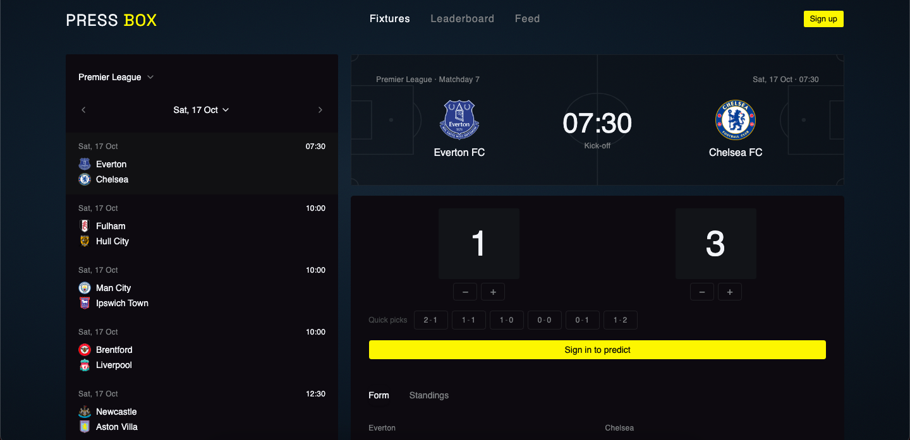

# Press Box

Predict football scores. Build a reputation.

Press Box is a score prediction app for European and Brazilian club football. Users predict scorelines before kickoff, earn points for accuracy, and build a public record over time. The leaderboard ranks everyone on their last 100 scored predictions, so it rewards current form rather than how long someone has been playing.

**Live:** [press-box-xi.vercel.app](https://press-box-xi.vercel.app)



---

## Features

- **Fixtures**: 10 competitions (Premier League, La Liga, Bundesliga, Serie A, Ligue 1, Champions League, Championship, Eredivisie, Primeira Liga, Brasileirão), browsable by date with a calendar picker. Each match shows recent form and the relevant standings.
- **Predictions**: submit or edit a scoreline any time before kickoff, with quick picks for common scores. Closed matches are locked.
- **Automatic scoring**: results are scored every 30 minutes without manual input.
- **Leaderboard**: ranked by points over each user's last 100 scored predictions, with average points and accuracy.
- **Profiles**: public stats and recent picks for every user.
- **Feed**: every prediction across the community, filterable by all, settled or pending, with final scores once settled.
- **Accounts**: email/password or Google sign-in, password reset, and a required username for Google sign-ups.

## Scoring

| Outcome                        | Points |
| ------------------------------ | ------ |
| Exact score                    | 3      |
| Correct result (win/draw/loss) | 1      |
| Wrong                          | 0      |

- Every match is judged on the **90-minute score**. Extra-time and penalty-shootout goals don't count, so a prediction means the same thing in every competition.
- A user's leaderboard score is their total over their **last 100 scored predictions**. At least 5 are needed to appear.

## Stack

| Layer         | Technology                                                           |
| ------------- | -------------------------------------------------------------------- |
| Frontend      | React 19, TypeScript, Vite, TanStack Query, React Router             |
| Styling       | Tailwind CSS v4, shadcn/ui (Radix)                                   |
| Backend       | Supabase: Postgres, Auth, Edge Functions (Deno), pg_cron, Vault      |
| Football data | [football-data.org](https://www.football-data.org) API               |
| Hosting       | Vercel (frontend), Supabase (backend)                                |
| CI            | GitHub Actions: lint, build, and type-checking of the Edge Functions |

## Architecture

```
Browser ──reads──────────────▶ Postgres (row-level security + column grants)
   │
   ├──fixtures, form, standings──▶ football-data-proxy ──▶ football-data.org
   │
   └──submit prediction────────▶ submit-prediction ──▶ football-data.org
                                        │                 (checks kickoff)
                                        └──writes──▶ Postgres

pg_cron (every 30 min) ──▶ score-predictions ──▶ football-data.org
                                  └──writes results and points──▶ Postgres
```

The browser can **read** public data directly. It **writes** only through Edge Functions, which use data they fetch themselves, never data supplied by the browser.

### Key decisions

**Football data goes through a proxy.** football-data.org doesn't allow browser requests (CORS) and requires a private API key. `football-data-proxy` handles both, and accepts only the three request shapes the app uses (fixtures by date range, team form, standings). Each parameter is checked against a strict pattern before it goes into the upstream URL.

**Predictions are submitted server-side.** `submit-prediction` takes only a match ID and a scoreline. It gets the user from their verified session token and fetches the match from football-data.org itself, then refuses the prediction if kickoff has passed. Because the browser never provides kickoff times, team names or crests, it can't falsify them to predict a match whose result is already known.

**Scoring runs on a schedule.** pg_cron calls `score-predictions` every 30 minutes. It scores unscored predictions on finished matches and stores the same 90-minute score it judged against, so the score displayed is always the one used for scoring. A scored prediction is never changed afterwards.

**Stats are computed, not stored.** Totals, averages, accuracy and rankings are calculated when requested, by Postgres functions (`get_leaderboard`, `get_profile_stats`, `get_feed`). The `predictions` table is the single source of truth, so there are no counters to drift out of sync.

**Match rows are created on demand.** A match is saved the first time someone predicts it, not by a full schedule sync. That keeps the database small on Supabase's free tier.

## Security model

Postgres enforces access with two layers: row-level security decides **which rows** a user can touch, and column grants decide **which columns**.

| Data                | Logged-out visitors         | Signed-in users                      | Edge Functions (service role) |
| ------------------- | --------------------------- | ------------------------------------ | ----------------------------- |
| Profiles            | read username and join date | same, plus update their own username | full access                   |
| Emails              | no access                   | no access                            | full access                   |
| Matches             | read                        | read                                 | write                         |
| Predictions         | read                        | read                                 | write                         |
| Points and outcomes | read                        | read                                 | write (scoring only)          |

- A database trigger also rejects any prediction made at or after kickoff by anything other than the server. Browsers currently have no write access at all, so it's a safeguard in case that's ever re-granted by mistake.
- The key the cron job uses to call the scoring function is stored in Supabase Vault, not in the job definition.
- The full schema, policies and grants are in [`supabase/migrations`](supabase/migrations).

## Project structure

```
src/
  features/         one folder per feature: auth, fixtures, predictions,
                    feed, leaderboard, profile, onboarding
    <feature>/hooks   data fetching (TanStack Query)
  components/ui/    shadcn/ui components
  components/layout/
  hooks/            shared hooks
  types/            Supabase-generated database types plus app types
supabase/
  functions/        football-data-proxy, submit-prediction, score-predictions
  migrations/       schema, policies, grants, cron schedule
```

## Running locally

**Frontend**

```bash
npm install
cp .env.example .env.local   # then fill in the two values below
npm run dev
```

| Variable                 | Where to find it                                    |
| ------------------------ | --------------------------------------------------- |
| `VITE_SUPABASE_URL`      | Supabase → Project Settings → API                   |
| `VITE_SUPABASE_ANON_KEY` | Supabase → Project Settings → API (publishable key) |

**Backend** (to run your own instance)

1. Create a Supabase project and enable the `pg_cron` and `pg_net` extensions (Database → Extensions).
2. Run the files in `supabase/migrations` in order, in the SQL Editor. Before running the cron migration (`…_schedule_scoring.sql`), change its function URL to your own project's.
3. Deploy the three functions in `supabase/functions`, and add a `FOOTBALL_DATA_API_KEY` secret (a free key from football-data.org).
4. Add a Vault secret named `score_predictions_auth` containing your project's secret key. The cron job reads it to call `score-predictions`.
5. Email sign-in works by default. Google sign-in needs a Google OAuth client configured under Authentication → Providers.

## Scripts

| Command         | Does                                |
| --------------- | ----------------------------------- |
| `npm run dev`   | Start the dev server                |
| `npm run build` | Type-check and build for production |
| `npm run lint`  | Run ESLint                          |

CI runs lint and build on every push to `main`, and type-checks the Edge Functions with Deno.

## Known limitations

- **Shared API quota.** The proxy, prediction submission and scoring all draw on one football-data.org free-tier quota (10 requests per minute), and there's no rate limiting per user yet. When the quota runs out, users see a "try again" message.
- **Scoring failures aren't reported.** If a scoring run is rate-limited or fails, the affected predictions stay unscored until a later run succeeds, and nothing flags it.
- **Knockout display.** Knockout matches are scored on the 90-minute result, but the extra-time or penalty outcome isn't shown alongside it yet.
